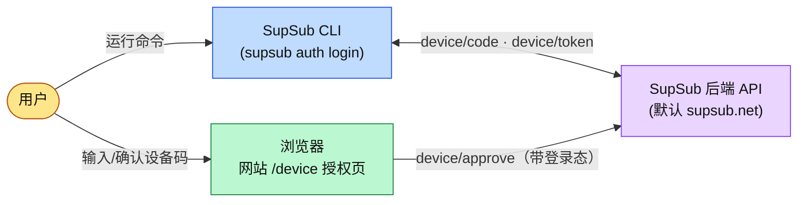
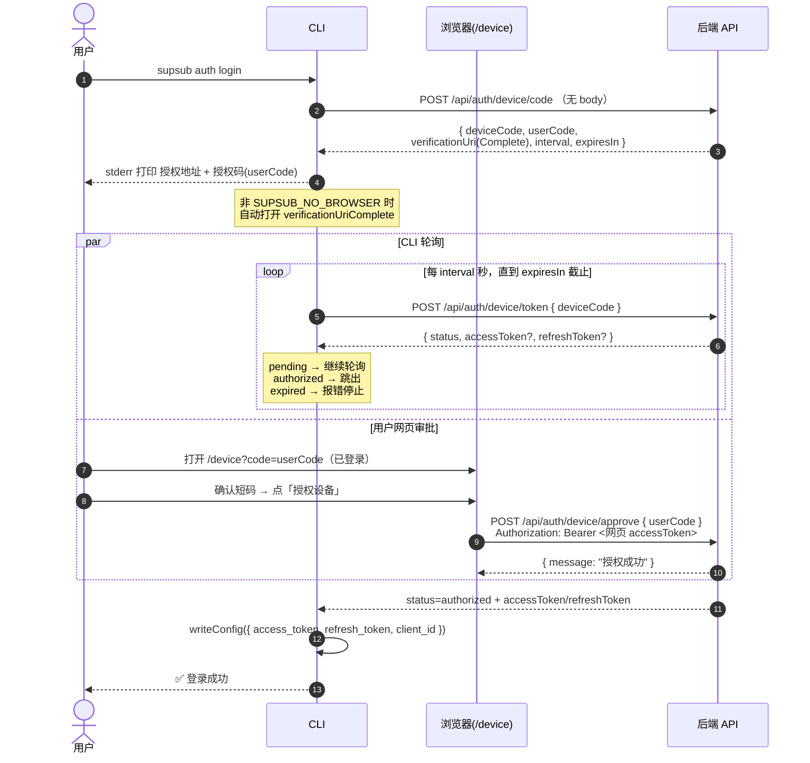
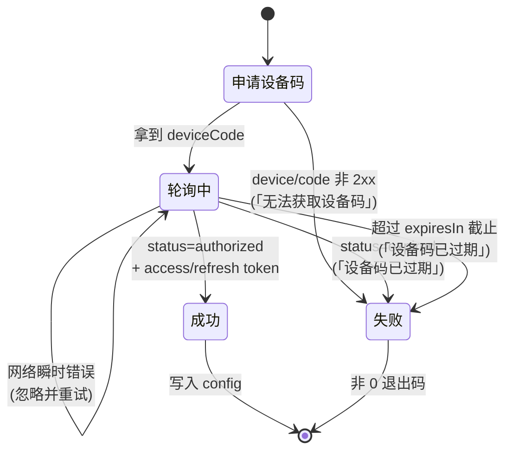
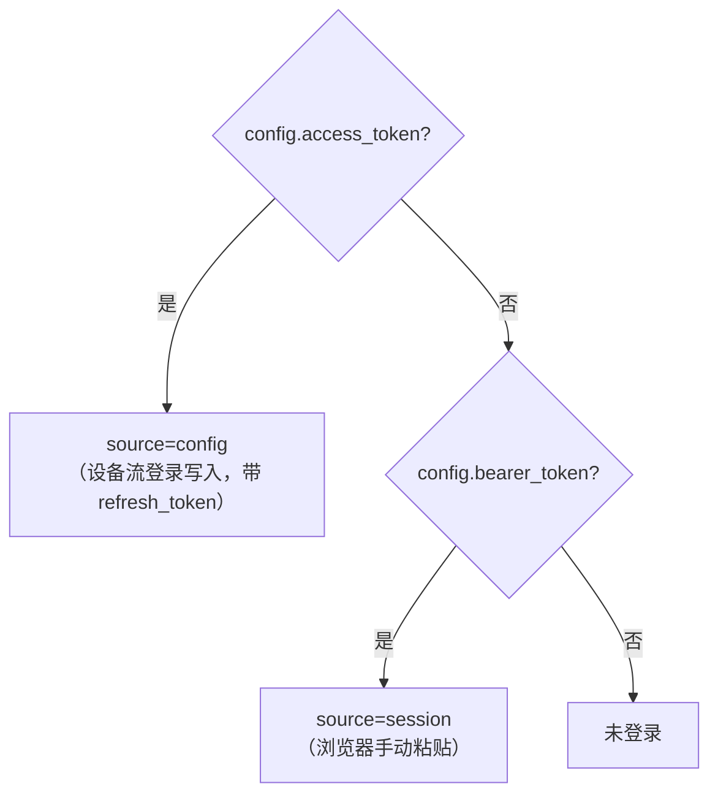
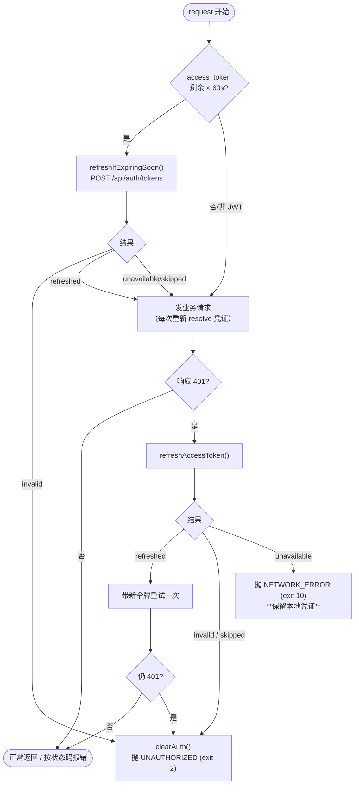
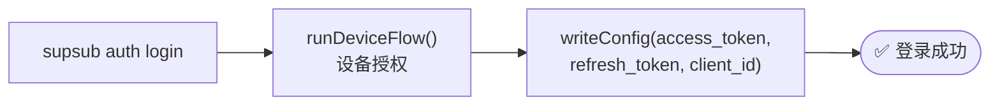

# SupSub CLI 授权流程（OAuth Device Flow）

> 本文以 mermaid 图为主，描述 `supsub auth login` 的设备授权（Device Flow）端到端流程、令牌轮询状态机、凭证解析优先级、**令牌自动续期**与相关端点契约。
> 实现位置：`src/api/auth.ts`、`src/commands/auth/device-flow.ts`、`src/commands/auth/login.ts`、`src/http/credentials.ts`、`src/http/token-refresh.ts`、`src/lib/jwt.ts`、`src/config/store.ts`、`src/http/client.ts`。

---

## 1. 角色与组件

- **CLI** 负责申请设备码、轮询授权状态、落地令牌。
- **浏览器 / 网站 `/device` 页** 负责让**已登录用户**确认短码并审批设备（携带网页登录态调用 `device/approve`）。
- **后端 API** 串联三个端点、签发令牌。CLI 默认基址为 `https://supsub.net`，可用 `--api-url` flag 或 `SUPSUB_API_URL` 环境变量覆盖（flag 优先级更高）。

---

## 2. 设备授权时序（主流程）

要点：
- `device/code`、`device/token` **不需要鉴权**，且**不走统一 `request()`**（避免 401→clearAuth 误触发），在 `src/api/auth.ts` 内用独立 `fetch` 实现。
- 授权地址优先用带码的 `verificationUriComplete`；缺失时回落 `verificationUri?user_code=<userCode>`。
- `device/token` 响应字段对 camelCase（`accessToken`）与 snake_case（`access_token`）均兼容。

---

## 3. 令牌轮询状态机

- `authorized` 但缺令牌 → 视为服务端异常，报「授权成功但未返回令牌」。
- 退出码遵循 `src/lib/exit-code.ts` 语义（`EXPIRED_TOKEN`/`SERVER_ERROR` 等映射为非 0）。

---

## 4. 凭证解析优先级（`resolveApiKey`）

每次请求由 `src/http/client.ts` 调 `resolveApiKey()` 解析出 Bearer 凭证，优先级从高到低：

设备授权是唯一登录入口，凭证解析因此只有两级——没有 flag / env / API Key 通道。

- 设备流登录把令牌写入 `config.access_token` / `config.refresh_token`（见 `src/config/store.ts` 的 `Config`）。
- `resolveApiKey()` **只在 key 取自 `config.access_token` 时**返回 `refreshToken`——`bearer_token` 是浏览器手动粘贴的临时凭证，没有续期通道，也不该被自动续期。
- 401 且续不成 → `client.ts` 调 `clearAuth()` 清除 `access_token`/`refresh_token`/`bearer_token`（连带抹掉老配置里可能残留的 `api_key`）。详见下一节。

---

## 5. 令牌自动续期（Refresh Token）

实测 JWT `exp`：`access_token` 有效期约 **24 小时**，`refresh_token` 约 **14 天**。
续期由 `src/http/token-refresh.ts` 编排，对命令层完全透明——命令代码不需要知道令牌续过期。

四种续期结局对应四种善后动作，不能合并：

| 结局 | 触发条件 | 善后 |
|---|---|---|
| `refreshed` | 2xx 且带回 `accessToken`（实测返回 **201**） | 新令牌写回 config，重试原请求 |
| `invalid` | 400 / 401（实测：`{"code":"Unauthorized","message":"无效的令牌"}`） | `clearAuth()` + `UNAUTHORIZED`，要求重新登录 |
| `unavailable` | 网络异常 / 5xx / 响应缺 `accessToken` | **保留凭证**，抛 `NETWORK_ERROR` 让用户稍后重试 |
| `skipped` | 当前来源没有 `refresh_token`（即 `bearer_token`） | 维持旧行为：401 直接 `clearAuth()` |

设计要点：

- **`unavailable` ≠ `invalid`**：一次网络闪断不该把用户登出。只有服务端明确判定令牌无效（400/401）才清凭证。
- **只重试一次**：续期成功后重试仍 401 → 直接登出，不进重试循环。
- **并发去重**：`refreshAccessToken()` 用一个 in-flight Promise 做单飞，省掉重复往返、避免两次 `writeConfig` 相互覆盖。（实测该后端换新令牌后旧 `refreshToken` 仍可用，所以并发换两次不会把人换登出——但没必要多打一发。）
- **重试必须重新解析凭证**：`client.ts` 里的 `send()` 每次都重新 `resolveApiKey()`，否则重试仍会带上旧的 `access_token`。
- **本地过期判断不验签**：`src/lib/jwt.ts` 只 base64url 解 `exp`。解析不出（浏览器粘贴的 `bearer_token` 这类非 JWT 凭证）就返回「不知道」，交给 401 兜底；主动续期遇上 `unavailable` 也照常发老令牌出去——本地时钟可能有偏差，老令牌说不定还能用。

---

## 6. 登录路径（唯一：设备授权）

设备授权是 `supsub auth login` 的唯一入口——没有 `--api-key` 之类跳过设备流的旁路。登录后 `supsub auth status` → `GET /api/user/info`（携带 Bearer）展示账号信息。

---

## 7. 端点契约（CLI 相关 4 个）

| 端点 | 方法 | 鉴权 | 请求 | 响应 |
|---|---|---|---|---|
| `/api/auth/device/code` | POST | 否 | 无 body | `{ deviceCode, userCode, verificationUri, verificationUriComplete, interval, expiresIn }` |
| `/api/auth/device/token` | POST | 否 | `{ deviceCode }` | `{ status: pending\|authorized\|expired, accessToken?, refreshToken? }` |
| `/api/auth/device/approve` | POST | 是（网页登录态） | `{ userCode }` | `{ message }` |
| `/api/auth/tokens` | POST | 否（凭 body 里的 `refreshToken`） | `{ refreshToken }`（长度 ≥ 41） | **201** `{ accessToken, refreshToken }`；令牌无效 → 401 `{ code: "Unauthorized", message: "无效的令牌" }`；长度不足 → 400 Validation error |

> 说明：`device/approve` 由**网站 `/device` 页**调用，CLI 不调用。基址 + path 拼接规则：CLI 请求 = `${SUPSUB_API_URL}` + 上述含 `/api` 前缀的 path。
> `device/token` 与 `tokens` 的响应字段对 camelCase / snake_case 均兼容；`tokens` 若未带回新的 `refreshToken`，CLI 沿用旧的。
>
> ⚠️ **实测修正（2026-07，以实际响应为准，api.json 滞后）**：`/api/auth/tokens` 成功时返回 **201**（api.json 写的是 200），代码用 `res.ok` 判成功；换新令牌后**旧 `refreshToken` 在有效期内仍可用**，服务端不作废旧令牌。

---

## 8. 环境变量

| 变量 | 作用 | 默认 |
|---|---|---|
| `SUPSUB_API_URL` | 覆盖 API 基址（等价于 `--api-url` flag，但 flag 优先级更高） | `https://supsub.net` |
| `SUPSUB_NO_BROWSER` | 真值时 `auth login` 不自动打开浏览器（e2e / 无头环境） | 未设 |
| `SUPSUB_CONFIG_DIR` | 覆盖配置目录（测试隔离用） | `~/.supsub` |
